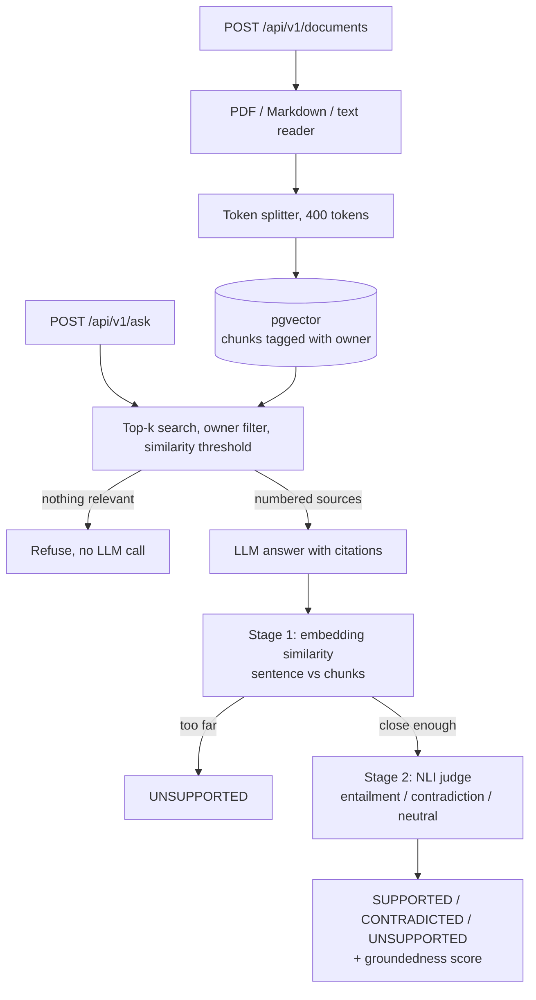

# DocuVerify

Ask questions about your own PDFs and documents and get answers that cite their sources. Every sentence of every answer is then checked against the retrieved text in two stages, so invented or contradicted statements are flagged instead of passed on silently.

**Stack:** Java 21, Spring Boot 4.1, Spring AI 2.0 (ChatClient, VectorStore, document readers), PostgreSQL 18 + pgvector (HNSW, cosine), Ollama (llama3.2, nomic-embed-text), Spring Security, JUnit 5, Mockito, Docker, GitHub Actions.

## How it works



1. **Ingest.** Files are read with Spring AI's PDF and text readers, split into token-sized chunks, tagged with `owner`, `documentId`, `source` and `chunk`, embedded and stored in pgvector.
2. **Retrieve.** The question is embedded; the top-k chunks above a similarity threshold are fetched, filtered to the caller's own documents. If nothing qualifies, the service answers "I could not find this in the uploaded documents" and never calls the model.
3. **Generate.** The model receives numbered sources and must cite every factual sentence as `[n]`.
4. **Verify.** Each sentence is checked:
   - a citation to a source that was not retrieved makes it `INVALID_CITATION`;
   - stage 1 compares its embedding with every retrieved chunk; below the threshold it is `UNSUPPORTED`;
   - stage 2 asks an NLI judge whether the closest and cited chunks entail, contradict or do not address it.
   The response carries a `groundedness` score (supported / total) and `needsReview=true` below `min-groundedness`.

## Why two stages

Embedding similarity measures topic, not truth. A sentence that changes "30 days" to "60 days" reuses the source's words and scores *higher* than an honest paraphrase. On the evaluation set below, similarity alone caught **3 of 16** contradictions; adding the NLI stage caught **15 of 16**.

## Evaluation (real models, not mocks)

44 hand-labelled claims (16 supported, 16 contradicted, 12 unsupported) over 4 policy documents, run against llama3.2 (3B) and nomic-embed-text on a laptop. Full per-claim results: [docs/evaluation.md](docs/evaluation.md).

| | Similarity only | Similarity + NLI |
|---|---|---|
| Hallucination recall | 25.0% | **96.4%** |
| Hallucination precision | 77.8% | 81.8% |
| F1 | 0.38 | **0.89** |
| Contradictions caught | 3 / 16 | 15 / 16 |
| Correct claims wrongly flagged | 2 / 16 | 6 / 16 |
| Time per sentence | 21 ms | 407 ms |

The trade-off is explicit: the 3B judge is strict and flags some correct paraphrases that need a small inference ("a week" = 7 days, "MFA"). Because flagged answers go to human review rather than being deleted, high recall is the safer default. Re-run with `./mvnw test -Dtest=GroundingEvaluation -Deval=true`.

## Bugs found by running it for real

- **Citations after the full stop were lost.** The model wrote "...finance head. [5]"; the splitter turned "[5]" into its own fragment and dropped it, so a citation to a non-existent source went unnoticed. Fixed by moving trailing citations into the sentence before splitting; covered by a test.
- **Small models cite line numbers.** With one long chunk, llama3.2 cited [4] and [5] as if counting sentences. The prompt now states the valid range ("cite only 1 to N"), and the verifier flags anything outside it.

## Run locally

```bash
# PostgreSQL 18 with pgvector, and Ollama
ollama pull llama3.2 && ollama pull nomic-embed-text
./mvnw spring-boot:run

curl -u asha:asha-pass -F file=@handbook.pdf localhost:8090/api/v1/documents
curl -u asha:asha-pass -H 'Content-Type: application/json' \
     -d '{"question":"How many days per week can I work from home?"}' localhost:8090/api/v1/ask
```

Or with Docker: `docker compose up -d` starts pgvector and Ollama. Demo users: `asha / asha-pass`, `ravi / ravi-pass`; each sees only their own documents. Tuning lives in `application.properties` (`docuverify.retrieval.*`, `docuverify.verification.*`). Swapping Ollama for another provider is a dependency and property change; the code depends only on Spring AI's `ChatModel`, `EmbeddingModel` and `VectorStore`.

## Tests

```bash
./mvnw verify
```

15 tests run without Ollama or a database, using a deterministic embedding model, a scripted chat model, a rule-based NLI judge and Spring AI's in-memory `SimpleVectorStore`. They cover grounded answers, invented sentences, contradictions that fool similarity but not NLI, invalid citations, per-user document isolation, refusal without an LLM call, embedding caching, abbreviation-safe sentence splitting, authentication and request validation.

## Known limitations and next steps

- One long chunk dilutes similarity (a correct answer about laptops was flagged in a live run); sentence-window chunking would help.
- A dedicated NLI cross-encoder (DeBERTa-MNLI) should beat the 3B chat model on precision and latency.
- Ingestion is synchronous; large PDFs should be processed asynchronously with a status endpoint.
